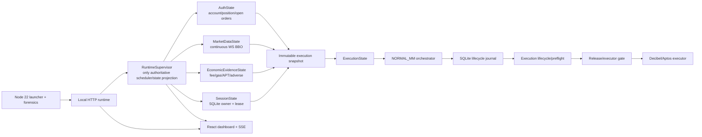

# Decibel BTC Bot — Project Handover

**Audit date:** 2026-10-21 (Asia/Bangkok)  
**Audited workspace:** `D:\study\Decibel_BTC_Bot`  
**Branch:** `chore/production-cleanup-v1`  
**HEAD:** `471e9ef` (`feat: establish lean decibel btc market maker production bot`)  
**Audit basis:** current working tree, including uncommitted and untracked files. No deleted conversation history was assumed.

## Evidence labels

- **VERIFIED:** directly supported by inspected source/configuration or a check run during this audit.
- **DOCUMENTED:** stated in repository documentation but not independently established.
- **INFERRED:** a conservative deduction from multiple pieces of workspace evidence.
- **UNKNOWN:** the workspace does not provide enough evidence.
- **CONFLICT:** authoritative-looking sources disagree.

## 1. Product and project overview

### Purpose

**VERIFIED:** The current working tree implements a deterministic automated market maker for the Decibel BTC/USD perpetual market. It reads authenticated account state and public market data, builds passive BID/ASK candidates, applies inventory, market, economic, lifecycle, and execution-safety gates, journals every mutation intent, reconciles outcomes against venue evidence, and exposes a local operator dashboard. Trading decisions do not call an AI model (`AGENTS.md`; `src/decibel_production_live_orchestrator_v1.ts`; `src/run_decibel_production_web_v1.ts`).

The current production workflow is:

1. launch a pinned Node 22.23.2 child with persistent process forensics;
2. bind the local HTTP dashboard before external initialization;
3. hydrate/rebuild authoritative Auth, MarketData, EconomicEvidence, Session, and Execution domain state;
4. reconcile durable non-terminal intents and session ownership;
5. start or recover an operator session;
6. evaluate NORMAL_MM deterministically and either HOLD, PLACE, CANCEL, reconcile, reduce risk, or unwind;
7. require explicit execution-mode gates before a venue mutation.

**INFERRED intended users:** a technically capable operator running one local Windows production instance and developers performing offline/shadow analysis. The web server binds only to `127.0.0.1`; there is no multi-user account model.

### Product boundaries

- **VERIFIED:** one hard-coded production market, BTC/USD perpetual; unrelated activity is treated as a scope/exclusivity concern.
- **VERIFIED:** local process + local SQLite/JSON/JSONL persistence; no hosted control plane is present.
- **VERIFIED:** authenticated reads, live WebSocket BBO, optional mainnet execution, shadow/replay/research commands, and a React operator UI are present.
- **VERIFIED:** the strategy is deterministic. AI is not a runtime dependency.
- **UNKNOWN:** commercial users, deployment topology beyond the local Windows launcher, SLA, profitability target, and roadmap.

### Maturity

**PARTIALLY IMPLEMENTED / PRE-PRODUCTION HARDENING.** The production-core suite is substantial (445 passing tests), and runtime forensics show repeated real-runtime verification work. However, the production architecture is largely uncommitted, documentation conflicts with implementation, live state files are untracked, and important safety/reliability issues have recently been under active repair. Passing mocked tests must not be equated with live-readiness.

## 2. Technology stack

| Area             | Verified implementation                                                                                                                                                                                |
| ---------------- | ------------------------------------------------------------------------------------------------------------------------------------------------------------------------------------------------------ |
| Language/runtime | Strict TypeScript 5.9.3, ESM, `tsx`; production child explicitly requires Node `v22.23.2` (`decibel_process_forensics_v1.ts`).                                                                         |
| Backend          | Native Node `http` server; no Express/Nest. Server-Sent Events at `/api/events`.                                                                                                                       |
| Frontend         | React 19.1.1 + ReactDOM, Vite 7.1.5, TypeScript, plain CSS, Fredoka font package.                                                                                                                      |
| Venue SDK        | `@decibeltrade/sdk` 0.7.0, with compatibility preflight in `decibel_sdk_runtime_v1.ts`.                                                                                                                |
| Chain            | `@aptos-labs/ts-sdk` 5.2.1 for Aptos transaction/evidence and execution integration.                                                                                                                   |
| HTTP             | `undici` 7.16.0 and native fetch-style bounded transport; authenticated reads can run in a dedicated worker.                                                                                           |
| Validation       | Zod 3.25.76 for environment, API payload, venue response, settings, and persisted-data validation.                                                                                                     |
| Persistence      | `better-sqlite3` 13.0.2; WAL and FULL synchronous mode for the execution journal; JSON/JSONL for economic evidence, raw BBO, settings, mode history, handoff, safety snapshots, and forensics. No ORM. |
| Logging          | Pino 10.3.1 plus rotating stdout/stderr and JSONL forensic event logs.                                                                                                                                 |
| Testing          | Vitest 4.1.10; 22 production-core test files.                                                                                                                                                          |
| Quality          | ESLint 10, Prettier 3.9.6, TypeScript no-emit typecheck.                                                                                                                                               |
| Deployment       | Windows-oriented launcher, pinned Node executable discovery, PowerShell watcher/setup scripts, local port 4173. No container/IaC/CI definition was found.                                              |

Dependency versions are from the current `package.json`; several use caret ranges, so only explicitly exact versions are truly pinned.

## 3. Repository structure

```text
.
├── AGENTS.md                         safety, naming, workflow, verification rules
├── README.md                         largely legacy/read-only/research documentation
├── package.json                      current production scripts and dependencies
├── .env / .env.example              runtime configuration (never disclose .env values)
├── config/
│   ├── decibel_regime_edge_model_v1.json
│   └── production_state/             sessions, settings, handoff and safety state
├── docs/                             production handoffs/specs; some are stale
├── scripts/
│   ├── setup_decibel_mcp_runtime_v1.ps1
│   └── start_decibel_external_process_watcher_v1.ps1
├── src/
│   ├── run_decibel_production_web_launcher_v1.ts
│   ├── run_decibel_production_web_v1.ts
│   ├── decibel_runtime_supervisor_v1.ts
│   ├── decibel_production_live_orchestrator_v1.ts
│   ├── decibel_production_live_state_source_v1.ts
│   ├── decibel_execution_*_v1.ts
│   ├── decibel_production_session*_v1.ts
│   ├── decibel_*economic* / *adverse* / *market_regime*_v1.ts
│   ├── decibel_authenticated_http*_v1.ts
│   ├── decibel_external_production_executor_v1.ts
│   └── run_decibel_*shadow/replay/audit/study*_v1.ts
├── tests/                             22 production-core suites, 445 tests
├── web_dashboard/
│   ├── index.html
│   ├── src/main.tsx
│   ├── src/presentation.ts
│   └── src/runtime_terminal.ts
└── data/                              ignored local runtime DB/evidence/log output
```

There are 83 files / about 29,017 lines under `src`, 22 test files / about 11,851 lines under `tests`, and a large local `data/decibel_execution_v1.sqlite` (about 713 MB at audit time). Generated data and dependencies were deliberately excluded from the tree.

### Actual entry points

- Primary web production command: `npm run decibel:production:web-v1` → Vite dashboard build → `run_decibel_production_web_launcher_v1.ts` → pinned Node child → `run_decibel_production_web_v1.ts`.
- Headless live command: `npm run decibel:production:live-v1` → `run_decibel_production_live_v1.ts`.
- Mutation-disabled/shadow and offline tools are separately exposed in `package.json`.
- External process watcher: `npm run decibel:production:watch-processes-v1`.

## 4. System architecture

### Authoritative runtime model

**VERIFIED:** `decibel_runtime_supervisor_v1` owns one keyed scheduler and the authoritative domain projection:

- `AuthState`
- `MarketDataState`
- `EconomicEvidenceState`
- `SessionState`
- `ExecutionState`

Explicit runtime phases are `BOOTSTRAP`, `RECOVERING`, `WAIT_AUTH`, `WAIT_ECONOMIC`, `READY`, `ACTIVE`, `DEGRADED`, `STOPPING`, and `ENDED`. Execution readiness is derived from current domain states, reconciliation state, inventory dust state, and a complete execution snapshot. Domain I/O workers may fetch data, but the supervisor publishes state.



### Critical runtime data flow

1. `decibel_client` maintains the single BTC depth subscription and normalizes metadata/book values.
2. `decibel_production_live_state_source_v1` reads authenticated account overview, positions, open orders, histories, fills, and public market state; it constructs source snapshots and authoritative reconciliation evidence.
3. Authenticated REST reads use `decibel_authenticated_http_reader_v1` and a dedicated `decibel_authenticated_http_worker_v1.mjs`; the parent client bounds every worker request. The supervisor owns logical retry/backoff.
4. `decibel_production_economic_refresh_v1` and `decibel_adverse_selection_evidence_v1` publish independently validated maker-fee, gas, APT/USD, and adverse-selection components into a complete economic snapshot.
5. The supervisor combines fresh auth, BBO, economics, and session state into an immutable execution snapshot.
6. `decibel_production_live_orchestrator_v1.evaluateOnce()` computes market regime and quote candidates, applies gates, selects a mutation, persists a decision snapshot, and invokes the lifecycle only when allowed.
7. `decibel_execution_lifecycle_v1` atomically claims a durable intent, applies preflight and mutation budgets, records `SUBMITTING`, invokes the executor once, and converts unknown outcomes into reconciliation-required state rather than retrying.
8. `decibel_production_live_state_source_v1.reconcileIntent()` searches open orders, terminal history, fills/trades, and transaction evidence. Absence alone is not terminal evidence.

### HTTP/API and UI

The Node server serves static Vite output and these local endpoints:

- `GET /api/telemetry`
- `GET /api/events` (SSE)
- `GET /api/runtime-snapshot`
- `GET /api/restart-safety` (performs fresh read-only checks and persists an audit snapshot)
- `GET /api/session`, `GET /api/session-history`
- `POST /api/session/start`, `/end`, `/resume-takeover`
- `GET/POST /api/operator-settings`
- `GET /api/execution-mode`; POST is intentionally rejected because `.env` is authoritative.

The dashboard is a read projection plus explicit operator controls. Start-button eligibility is intended to match backend session-safety semantics rather than strategy admission. The server is loopback-only and has CSP/header hardening, but no HTTP authentication layer; the operating-system/local-host boundary is therefore security-significant.

### Persistence model

**Execution journal** (`decibel_execution_lifecycle_journal_v1.ts`): intents, mutation attempts, executor outcomes, reconciliation observations/provenance, fill provenance, authenticated mainnet snapshots/fills, transitions, blockers, strategy decision snapshots, and aggregate lifecycle state. Mutation keys and client-order IDs enforce idempotency; same-side active intents enforce side ownership.

**Session store** (`decibel_production_session_v1.ts`): one partial unique index permits only one `STARTING`/`RUNNING`/`STOPPING` session. Rows persist owner PID/instance, heartbeat, separate recovery lease, takeover pause, unwind latch, config snapshot, and final accounting.

**Other stores:** canonical raw WS BBO JSONL; component economic evidence JSON; operator-settings JSON + audit JSONL; restart-safety JSON; process forensic JSONL and rotating logs.

Schema evolution is inline (`CREATE TABLE IF NOT EXISTS` plus column checks/`ALTER TABLE`), not a separate migration framework.

## 5. Feature inventory and status

| Feature                                               | Status                                             | Evidence / limits                                                                                                                                                                                      |
| ----------------------------------------------------- | -------------------------------------------------- | ------------------------------------------------------------------------------------------------------------------------------------------------------------------------------------------------------ |
| RuntimeSupervisor domain state and keyed scheduler    | IMPLEMENTED & VERIFIED                             | `decibel_runtime_supervisor_v1.ts`; extensive telemetry tests; no-emit typecheck and tests pass.                                                                                                       |
| Authenticated snapshot freshness/singleflight         | IMPLEMENTED & VERIFIED (mock/test)                 | 5-second freshness semantics, deadline refresh, bounded worker transport; HTTP reader/worker tests pass. Live reliability has historically required repeated fixes.                                    |
| Continuous BTC BBO subscription and market projection | IMPLEMENTED & VERIFIED (mock/test)                 | WS lifecycle, reconnect diagnostics, generation-based projection tests. Recent runtime work specifically fixed stale/missing execution projections; prolonged production verification remains prudent. |
| Component economic evidence                           | IMPLEMENTED & VERIFIED (mock/test)                 | Independent fee/gas/APT/adverse components and immutable snapshot; 30 effective samples, 1-hour TTL, global fallback.                                                                                  |
| Market-regime-aware quoting                           | IMPLEMENTED BUT NOT FULLY RUNTIME-VERIFIED         | QUIET/NORMAL/FAST/ONE_SIDED/THIN policy; current production logic and runtime evidence exist, but profitability/representativeness are not established.                                                |
| Lifecycle-cost admission                              | IMPLEMENTED & VERIFIED                             | 11.25 bps hard cap, 11.035 entry threshold (0.215 hysteresis), side-specific gas/candidate checks.                                                                                                     |
| Inventory-aware sizing and anti-flip                  | IMPLEMENTED & VERIFIED (tests)                     | exact authenticated position, reduction cap, untradeable dust, flat-pair shared sizing cohort.                                                                                                         |
| Strategic reprice safety                              | IMPLEMENTED & VERIFIED (tests)                     | commit-time fresh revalidation, frozen replacement, separate safety cancels, duplicate suppression.                                                                                                    |
| Durable intent lifecycle and ACK recovery             | IMPLEMENTED & VERIFIED (tests)                     | journal states, provenance, multi-intent recovery, no terminal inference from absence.                                                                                                                 |
| Live Decibel executor                                 | IMPLEMENTED BUT HIGH-RISK / CONFIG-GATED           | lazy signer/write client, PostOnly and reduce-only IOC, exact cancel. No mutation tests. Documentation still says executor absent.                                                                     |
| Session ownership/recovery/unwind                     | IMPLEMENTED & VERIFIED (tests)                     | PID+instance owner, recovery lease, CAS promotion, heartbeat, paused takeover, terminal accounting.                                                                                                    |
| Restart safety gate                                   | IMPLEMENTED & VERIFIED                             | requires fresh auth, flat position, no open orders, no unresolved/inflight intents.                                                                                                                    |
| Operator dashboard                                    | IMPLEMENTED & VERIFIED (component tests)           | React UI, telemetry/SSE, sessions/settings. No browser E2E suite was found.                                                                                                                            |
| Process forensics / watcher                           | IMPLEMENTED & VERIFIED (unit tests)                | Node pin, rotating logs, process identity/death order; watcher is externally launched and never restarts the bot.                                                                                      |
| Shadow/replay/economic studies                        | IMPLEMENTED BUT NOT RUNTIME-VERIFIED IN THIS AUDIT | multiple explicit scripts and persisted local artifacts.                                                                                                                                               |
| Legacy README research/paper platform                 | CONFLICT / UNKNOWN                                 | README describes many commands/files no longer present in current `package.json`/tree. Treat it as historical, not current operational truth.                                                          |

## 6. Core business logic and invariants

Future changes must preserve these unless the user explicitly authorizes policy changes:

### Market/account truth

- Only authenticated venue position is inventory truth; zero is FLAT, non-zero below venue minimum is `UNTRADEABLE_DUST`, never FLAT.
- Auth, market, and economic freshness are independent domains. A failure in one must not corrupt another.
- A current BBO is execution-ready only with a healthy connected/subscribed feed and age `<= 5000 ms` (configured production default).
- No new mutation may use stale/incomplete auth, book, economics, session ownership, or reconciliation state.

### Quote policy

- Production BTC/USD candidates are passive and tick/lot normalized.
- At most one live/pending BID and one live/pending ASK, including PREPARED/SUBMITTING/ACKNOWLEDGED journal ownership.
- Hard lifecycle cost cap: 11.25 bps; new-entry threshold: 11.035 bps; hysteresis: 0.215 bps (`decibel_smart_ladder_v1.ts`).
- Candidate distances are based on `[5,6,7,8,9,10,12]` bps and regime multipliers.
- Neutral inventory band is USD 2.50; hard inventory limit constant is USD 50. Environment/operator limits impose additional constraints.
- While authenticated inventory is exactly flat, a flat-pair cohort freezes one shared lot-aligned quantity across BID/ASK cycles. When non-flat, exposure-increasing quoting is suppressed and reducing quantity is capped at exact position size.
- Untradeable dust permits runtime/session recovery but blocks execution until authenticated position is exactly zero.

### Economic evidence

- Required components: maker fee, gas P95, APT/USD dependency, adverse estimate, safety margin, and lifecycle thresholds.
- Each component publishes independently; READY requires one complete immutable snapshot.
- Synthetic BBO adverse evidence is separate from realized maker-fill adverse evidence.
- Synthetic estimator deduplicates unchanged BBO, uses block-aware/non-overlapping 1s/5s/15s/30s markouts, requires 30 effective 30-second samples, and expires after one hour.
- Prefer current-regime P95; otherwise a representative canonical GLOBAL fallback is allowed. Never copy one regime bucket into another.

### Execution and reconciliation

- Mainnet requires validated mode/network gates, executor enabled, and live trading enabled. Live execution is disabled by safe defaults.
- Every PLACE passes preflight: exact market/side, tick/lot, venue minimum, notional bounds, PostOnly (except reduce-only unwind IOC), no self-trade, external counterparty required, and anti-flip constraints.
- An unknown submission outcome is never blindly retried. It becomes `SUBMIT_UNKNOWN`/reconciliation-required.
- Terminal state requires authoritative terminal/history/fill/transaction evidence or explicit safe operator recovery; absence from open orders alone is insufficient.
- Reconciliation provenance records source, matched identifier, venue state, remaining quantity, transaction/order/client IDs, and timestamp.
- Strategic reprice cancel requires fresh auth/BBO/economics, owned OPEN order, valid improving frozen replacement, and inventory safety at commit time. Auth transient aborts strategic cancel; explicit hard-safety cancel remains allowed.
- Mutation budgets are finite. Unknown outcome blocks until reconciled; action/total rate limits expose finite next-available deadlines.

### Session/process ownership

- Exactly one proven PID+instance owns an active session.
- Recovery uses a separate lease; final owner identity is promoted atomically only after fresh auth, journal reconciliation, and previous-owner absence.
- Only owner may heartbeat, trade, cancel, unwind, or mutate session state.
- Economic warming is `WAIT_ECONOMIC`, not operator pause; it may not block session creation but does block quoting.
- End Session is owner-only, requests unwind, and terminalizes only after journal resolution plus fresh FLAT/no-open-order confirmation.
- HTTP READY must precede external network initialization so blockers remain observable.

### Important policy conflict

**CONFLICT — HIGH IMPACT:** `AGENTS.md` states “Every new position must have a stop-loss.” Current `place_intent_v1` standard maker orders have no stop-loss attachment, and the production orchestrator treats active TP/SL activity as exclusivity loss. The code uses inventory limits and later reduction/unwind, but that is not the same invariant. Do not declare live readiness until the user resolves whether market-making inventory is exempt or a venue-supported protective-order lifecycle must be implemented and reconciled.

## 7. Architecture decisions and conventions

- Strict TypeScript and Zod at external boundaries.
- Repository-specific naming is intentional: lowercase snake_case classes, PascalCase instances, verb-first camelCase functions, snake_case files (`AGENTS.md`).
- Versioned module/type constants (`*_v1`) make persisted and operational contracts explicit.
- Fail closed with stable machine-readable blocker strings; never silently fill unknown values.
- Immutable `Readonly`/`Object.freeze` state is pervasive.
- Strategy, state source, lifecycle journal, executor, sessions, economics, and UI projections are separate modules, though the web runner/orchestrator are now large integration points.
- Durable mutation before I/O; authoritative reconciliation after uncertain I/O.
- UI is a projection/control input, not an authority for venue/account truth.
- `.env` is the current authoritative execution-mode tuple. `decibel_persisted_execution_mode_v1.ts` retains historical naming and a store class, but `loadDecibelPersistedExecutionModeV1()` derives effective mode from environment; the API refuses mode writes.
- Production child runtime is pinned to Node 22.23.2 to avoid a known Node 24/Got/p-cancelable crash path.
- Secrets are lazy-loaded only by the executor and must never enter telemetry, journals, fixtures, or logs.

## 8. Current development state

### Git state

**VERIFIED:** work is not on `main`, satisfying the branch rule. HEAD equals `origin/main`, but the working tree contains a very large uncommitted refactor:

- 28 tracked files modified;
- roughly 12,015 insertions / 1,076 deletions in tracked diffs;
- many untracked production modules, tests, docs, dashboard files, and local production-state files;
- the largest tracked changes are the live orchestrator and its tests.

Most recent committed history established the lean bot, market scope, production orchestration, Node 22 readiness, executor readiness, and execution lifecycle. The uncommitted focus is production stabilization: single-owner supervision, auth worker isolation, market/economic projections, session recovery, ACK provenance, anti-flip sizing, reprice safety, process forensics, and the web control plane.

### Current local runtime evidence

During the audit, `http://127.0.0.1:4173/api/telemetry` was reachable and returned a runtime state of `RECONCILE_ONLY`. Several expected summary fields were null under the quick probe, so the audit does **not** classify the currently running instance as healthy or source-matched. No venue mutation or runtime control operation was performed.

### Documentation conflicts

- `README.md` describes a much broader legacy read-only/paper/research system and commands absent from the current manifest.
- `docs/decibel_external_executor_plugin_v1.md` says a live executor exists; `docs/decibel_production_executor_handoff_v1.md` says no executor is included. Current source includes one.
- `.env.example` is dominated by legacy settings and does not document the complete current production web execution-mode tuple.
- Many production modules/docs are untracked and therefore absent from a clean clone.

## 9. Testing and verification

Commands actually run on 2026-10-21:

| Command                | Result                                                                                  |
| ---------------------- | --------------------------------------------------------------------------------------- |
| `npm run format:check` | PASS — all matched files use Prettier style.                                            |
| `npm run lint`         | PASS — exit 0, no findings.                                                             |
| `npm run typecheck`    | PASS — production tsconfig, `--noEmit`.                                                 |
| `npm test`             | PASS — 22 files, 445 tests.                                                             |
| `npm run build`        | NOT RUN — emits `dist/`, violating this audit’s “only modify PROJECT_HANDOVER.md” rule. |

The test suite is strong around deterministic strategy/lifecycle behavior, projection convergence, session ownership, ACK recovery, safety gates, transport timeouts, and presentation logic. It uses mocks for venue mutations. Missing or unverified layers include browser E2E, real venue contract tests in this audit, long-duration soak under the current exact working tree, crash/power-loss testing at OS level, and clean-clone verification of untracked files.

## 10. Known issues, technical debt, and risks

### Confirmed

1. **Critical — uncommitted architecture:** essential production files and tests are untracked. A clean checkout cannot reproduce the audited bot.
2. **High — stop-loss policy conflict:** described in section 6.
3. **High — documentation/config drift:** README, handoff docs, `.env.example`, and current source disagree.
4. **High — local production state is untracked in the repository directory:** SQLite WAL/SHM, settings audit, handoff, execution-mode, and restart-safety files appear in `git status`. They must remain uncommitted and may contain operational metadata.
5. **Medium — large integration modules:** `run_decibel_production_web_v1.ts`, `decibel_production_live_orchestrator_v1.ts`, and `decibel_production_live_state_source_v1.ts` concentrate substantial cross-domain behavior and are regression-sensitive.
6. **Medium — execution-mode naming debt:** “persisted execution mode” APIs remain although runtime mode is environment-authoritative; this invites incorrect future assumptions.
7. **Medium — generated-data growth:** the execution journal is hundreds of MB, and strategy snapshots are persisted every cycle. No retention/compaction policy was found.
8. **Medium — local API trust boundary:** mutation-capable session/settings endpoints have no application authentication, relying on loopback/OS access.

### Potential risks requiring validation

- Package ranges can drift despite the “pinned when compatibility matters” rule; notably Node runtime is 22 while `@types/node` is 26.
- Scheduler job failures are caught to preserve liveness; correctness depends on every domain job publishing its own failure state.
- Inline SQLite migrations and very large live DBs increase upgrade/recovery risk.
- Current strategy economics use a synthetic BBO adverse proxy for admission when representative; realized maker-fill adverse evidence remains separately modeled but is not necessarily the selected admission input.
- No clean-clone/CI evidence proves the many untracked modules are complete and portable.

## 11. Next development priorities

### Existing work implied by evidence

1. Preserve and review the current stabilization work without mixing unrelated refactors.
2. Runtime-verify the current exact build under mutation-disabled conditions: auth cadence, continuous BBO, economic evidence, projection convergence, session ownership, and decision cycles.
3. Resolve any non-terminal intents before restart or activation; never manually rewrite journal state without authoritative evidence.

### Audit recommendations (not an existing roadmap)

1. Resolve the stop-loss policy conflict before live activation.
2. Separate source changes from local runtime state, review the complete diff, and commit a reproducible focused series.
3. Rewrite README and production docs from current implementation; update `.env.example` with names/safe placeholders only.
4. Add CI for format/lint/typecheck/test/build and a clean-clone test.
5. Define journal retention/archive policy without weakening auditability.
6. Add browser/API E2E and deterministic crash-at-PREPARED/SUBMITTING/ACK tests.
7. Review local endpoint authorization if the dashboard may ever bind beyond loopback.

## 12. Guidance for future ChatGPT → Codex work

Every implementation prompt should:

1. State whether venue mutations, config writes, journal writes, process control, and network access are allowed. Default to none.
2. Require inspection of the exact running/source build and authoritative persisted state before diagnosing runtime behavior.
3. Name the authoritative owner: RuntimeSupervisor for runtime state/scheduling, authenticated source for position/open orders, canonical economic store for evidence, session store for ownership, lifecycle journal for intents.
4. Forbid new timers, retry loops, state owners, direct auth readers, and alternate projections unless an architectural review explicitly approves them.
5. Preserve the 5-second auth/book freshness policy, 30-sample/1-hour adverse policy, 11.25/11.035/0.215 lifecycle policy, max-one-order-per-side, anti-flip, and no-blind-retry invariants unless the user explicitly changes policy.
6. Demand exact evidence for terminalization; absence alone never resolves an order.
7. Require mock-only tests for execution behavior. Never insert real credentials.
8. Ask Codex to report root cause, files/symbols changed, invariants preserved, tests run, runtime verification status, and blockers.
9. Scope symptom fixes through the authoritative state transition that owns the behavior; do not add another latch/projection.
10. Escalate changes to supervisor domains, session ownership, journal states/schema, execution preflight, economic estimators, or live executor as architectural review tasks.

Suggested prompt structure:

```text
TASK / observed evidence
Authority and allowed mutations
Invariant to establish
Exact modules to audit (not assumptions)
Forbidden policy/config changes
Required deterministic tests
Required verification commands
Structured return fields, including BLOCKER
```

## 13. Unknowns and missing historical context

- Why the deleted planning conversation selected the present thresholds and exact operational policies.
- Whether the user considers market-making inventory exempt from the repository stop-loss rule.
- Which untracked files are approved, experimental, or ready to commit.
- Intended deployment beyond one local Windows machine.
- Profitability expectations and acceptance criteria.
- Formal incident history; local logs show evidence, but no authoritative incident register exists.
- Whether stale legacy README functionality should be restored, archived, or deleted.
- Retention/compliance requirements for journals, fills, telemetry, and process logs.
- Whether production API authentication is required beyond loopback isolation.

## 14. Quick start for a new ChatGPT

This is a deterministic TypeScript BTC/USD perpetual market maker for Decibel. The current implementation is a large uncommitted production-hardening refactor, not the read-only bot described at the top of the legacy README. The main process is a pinned Node 22 child serving a React dashboard on loopback. `RuntimeSupervisor` owns one scheduler and authoritative Auth, MarketData, EconomicEvidence, Session, and Execution domain projections. Auth comes from bounded isolated HTTP reads; market data comes from one continuous WS BBO owner; economics combines independently refreshed fee, gas, APT/USD, and block-aware adverse evidence; sessions use SQLite PID/instance ownership and recovery leases; mutations use a durable intent journal and authoritative reconciliation.

The core strategy is NORMAL_MM with regime-aware distance/size/rest/reprice policy, but hard safety/economic rules dominate. New quotes require fresh complete state, lifecycle cost `<=11.035` bps; resting quotes may remain only through `11.25` bps. Adverse evidence needs 30 effective non-overlapping samples within one hour. Maintain max one BID and one ASK, flat-pair equal sizing, authenticated inventory truth, anti-flip reductions, untradeable-dust blocking, PostOnly behavior, no self-trade, finite mutation budgets, and no retry of unknown submissions. Terminalize only with authoritative evidence and persist provenance atomically.

All 445 production-core tests, formatting, lint, and no-emit typecheck passed during this audit. Build was intentionally not run because it writes generated files. The key risks are untracked production code/state, documentation drift, large integration modules/database growth, and the unresolved conflict between `AGENTS.md` requiring a stop-loss for every new position and the current standard maker-order model lacking attached stop-loss lifecycle.

Immediate safe next steps: resolve that policy conflict; review and organize the uncommitted diff; update docs/config examples; mutation-disabled soak the exact source build; then commit focused, reproducible changes. Future Codex prompts must identify the authoritative state owner, prohibit duplicate loops/projections, specify allowed mutations, preserve thresholds unless explicitly authorized, and demand deterministic tests plus structured evidence.
